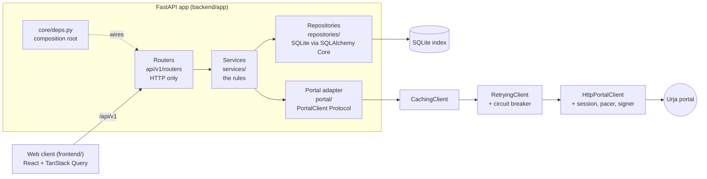

# Urja Meter API

A clean, documented HTTP API, and a small web client, in front of **Urja Meter Ops**, a legacy utility portal that has no API.

The service logs in to the portal like a normal user, reads its data politely, and copies it into a local index. From there it serves the data as a versioned JSON API with one error shape, one list shape, and an OpenAPI 3.1 contract. It can also answer questions the portal can't: combinable filters, "what's near here?", the network hierarchy, data-quality problems, consumption per interval, anomalies and transformer loading.

| Where to look | What it is |
|---|---|
| [`PROTOCOL.md`](PROTOCOL.md) | How the portal actually works: data, auth, signing, quirks, rate limit |
| [`openapi.json`](openapi.json) | The API contract (OpenAPI 3.1), generated from the code and checked in CI |
| `http://localhost:8000/docs` | Swagger UI for the running API |
| [`docs/decisions.md`](docs/decisions.md) | Architecture decision records ADR-001 to ADR-020 |
| [Reflection](#reflection) | The five reflection questions, answered |

---

## Contents
1. [Quick start](#1-quick-start)
2. [Sample requests](#2-sample-requests)
3. [What the API offers](#3-what-the-api-offers)
4. [How it is structured](#4-how-it-is-structured)
5. [How it works](#5-how-it-works)
6. [Testing](#6-testing)
7. [Assumptions](#7-assumptions)
8. [Design decisions and trade-offs](#8-design-decisions-and-trade-offs)
9. [What I intentionally left out](#9-what-i-intentionally-left-out)
10. [What I would improve with more time](#10-what-i-would-improve-with-more-time)
11. [Reflection](#reflection)

---

## 1. Quick start

**Prerequisites:**
- [uv](https://docs.astral.sh/uv/getting-started/installation/), which installs Python 3.13 itself.
- Node.js 20 or newer, for the web client only.
- `make`.
- Internet access to `https://urja-ops.flockenergy.tech`.

```bash
git clone <this repository's URL> && cd <the cloned folder>
cp .env.example .env          # then put the portal login from the assignment email into .env
make install                  # backend dependencies (uv sync --locked)
make run                      # API on http://localhost:8000  (Swagger UI at /docs)
```

`.env` needs three values. Everything else has a safe default, listed in `.env.example`.
```
URJA_PORTAL_URL=https://urja-ops.flockenergy.tech
URJA_PORTAL_EMAIL=<from the assignment>
URJA_PORTAL_PASSWORD=<from the assignment>
```
If a value is missing or invalid, the API refuses to start and names the setting, e.g. `Invalid configuration: missing or invalid portal_password. See .env.example.` A wrong password is only detected at the first portal call, which fails with `502 upstream_auth_failed`. Auth failures also count towards the circuit breaker, so the portal isn't hammered with logins.

**What happens on first start:**
1. The SQLite index (`backend/urja.db`) is created and migrated.
2. Because the index is empty, a **background sync** starts. The API still serves requests during it.
3. The sync pulls all 403 meters in one signed bulk export, then the 40 transformers, then every meter's readings. It is deliberately paced at 1.5 requests/s to stay under the portal's rate limit, so it takes **about 5 minutes**.
4. Until it finishes, meter search answers straight from the portal. Index-only features such as filters, facets, geo search and analytics answer `409 index_not_ready`.
5. Follow progress with `curl localhost:8000/api/v1/sync/status`. Its `counts` fill in as each phase finishes.

**Web client** (in a second terminal):
```bash
make web-install              # npm ci
make web                      # http://localhost:5173 (proxies /api to :8000)
```
`npm ci` reports audit warnings. They are all in dev tooling (build, test and lint). `npm --prefix frontend audit --omit=dev` reports **0** vulnerabilities in what ships to the browser.

**Checks:**
```bash
make check                    # backend: ruff, mypy --strict, layering check, tests, openapi drift
make check-all                # + web: eslint (incl. boundaries), vitest, production build, API-types drift
make test-live                # opt-in: the portal contract suite against the real portal
```

---

## 2. Sample requests

Faulty HPL meters, two per page (served from the index):
```bash
curl -s 'localhost:8000/api/v1/meters?status=faulty&make=HPL&page_size=2'
```
```json
{
  "items": [
    {"meter_id": "J100018", "serial_no": "GE50943", "make": "HPL", "phase_type": "single", "install_status": "faulty", "dt_code": "DT-019"},
    {"meter_id": "J100052", "serial_no": "AL37982", "make": "HPL", "phase_type": "single", "install_status": "faulty", "dt_code": "DT-013"}
  ],
  "page": 1, "page_size": 2, "total": 23, "total_pages": 12, "has_next": true
}
```

Daily consumption for one meter, derived from the portal's cumulative registers:
```bash
curl -s 'localhost:8000/api/v1/meters/J100000/readings?resolution=daily&start=2026-06-29&end=2026-06-30'
```
```json
{
  "meter_id": "J100000", "resolution": "daily", "interval_minutes": 30, "interval_kind": "half_hourly",
  "points": null,
  "buckets": [
    {"start": "2026-06-29T00:00:00+05:30", "end": "2026-06-30T00:00:00+05:30", "kwh": 20.3, "kvah": 21.92,
     "power_factor": 0.926, "avg_voltage": 230.6, "readings": 48, "flags": []},
    {"start": "2026-06-30T00:00:00+05:30", "end": "2026-07-01T00:00:00+05:30", "kwh": 19.87, "kvah": 21.46,
     "power_factor": 0.926, "avg_voltage": 229.1, "readings": 47, "flags": []}
  ],
  "summary": {"total_kwh": 40.17, "total_kvah": 43.38, "avg_voltage": 229.8, "readings": 96, "gaps": 0, "resets": 0,
              "first_at": "2026-06-29T00:00:00+05:30", "last_at": "2026-06-30T23:30:00+05:30"},
  "meta": {"source": "portal", "fetched_at": "…", "stale": false}
}
```

Errors always have the same shape. For example, an invalid meter ID:
```bash
curl -s localhost:8000/api/v1/meters/J12
```
```json
{"error": {"code": "validation_error", "message": "Request validation failed",
           "details": {"errors": [{"loc": ["path", "meter_id"], "msg": "String should match pattern '^J\\d{6}$'", "type": "string_pattern_mismatch"}]}}}
```

---

## 3. What the API offers

All routes are under `/api/v1`. The full schemas, parameters and per-route error statuses are in [`openapi.json`](openapi.json) and at `/docs`.

| Area | Endpoints | Notes |
|---|---|---|
| Health | `GET /health`, `GET /health/ready` | Readiness reports the portal circuit breaker and the index state, and makes no portal calls |
| Meters | `GET /meters`, `GET /meters/facets`, `GET /meters/{id}` | Combinable filters: `q, status*, make*, phase, install_type, dt, feeder, substation, subdivision, division, circle, zone, has_geo, sort`. Facet counts for filter chips. Detail includes hierarchy, geo and freshness `meta` |
| Readings | `GET /meters/{id}/readings?start&end&resolution=raw\|hourly\|daily` | Consumption per interval from cumulative registers, with gaps, resets, power factor and a summary |
| Transformers | `GET /transformers`, `GET /transformers/{code}`, `GET /transformers/{code}/meters` | DT list with meter counts |
| Geo | `GET /geo/near?lat&lng&radius_km`, `GET /geo/bbox?min_lat&…` | Haversine-sorted nearby meters; viewport search for the map |
| Hierarchy | `GET /hierarchy?depth`, `GET /hierarchy/node?id`, `GET /hierarchy/node/meters?id` | Zone → Circle → Division → Subdivision → Substation → Feeder → DT, with counts and status breakdowns |
| Data quality | `GET /data-quality?check&severity` | The portal's inconsistencies as a report (e.g. DT-007's two names, 22 repaired blank fields) |
| Analytics | `GET /analytics/summary`, `/consumption?node&resolution`, `/top-consumers`, `/anomalies`, `/transformers/load`; `GET /meters/{id}/anomalies` | Fleet KPIs, roll-ups per hierarchy node, rule-based anomalies, estimated transformer loading |
| Sync | `POST /sync`, `GET /sync/status` | Refreshes the index in the background (202), one run at a time (409) |

**Conventions:**
- Lists return `{items, page, page_size, total, total_pages, has_next}`, with `page_size` ≤ 200.
- Errors return `{"error": {"code", "message", "details"}}`, and a 500 includes the `request_id`.
- Every response carries `X-Request-ID`.
- Timestamps are ISO 8601 with the `+05:30` offset.

---

## 4. How it is structured



**Layer rules:** `scripts/check_layering.py` enforces these in CI, using an AST import checker.
- **Routers** handle HTTP only: they validate with Pydantic, call **exactly one** service method, and map the result to a response model.
- **Services** hold the rules. They never import FastAPI, SQLAlchemy or a concrete portal class, and they raise domain exceptions, never HTTP errors.
- **Repositories** are the only code that touches SQLite. **The portal adapter** is the only code that touches the portal.
- Concrete classes are constructed **only** in `app/core/deps.py`. Every swappable part is a `Protocol`, so replacing an implementation is a one-line change there, and tests swap them with `app.dependency_overrides`.
- Environment variables are read only in `app/core/config.py`, validated at startup. `main.py` is about 40 lines.
- One table in `app/core/errors.py` maps domain exceptions to HTTP status codes.

**Seams, one sentence each:**

| Seam (Protocol) | Implementations | Why it exists |
|---|---|---|
| `PortalClient` | `FakePortalClient`, `HttpPortalClient`, `RetryingClient`, `CachingClient` | Retry, cache and the real HTTP client all have the same shape, so they nest and one contract suite proves all of them (and the live portal) behave alike. |
| Parser registry | One parser per payload kind, plus a sub-registry for the two meter-detail formats | The portal returns two detail formats and devalue-encoded route data; a registry adds a format without touching the others. |
| `Clock`, sleeper, jitter | `SystemClock` / `FakeClock`, `FakeSleeper` | Time-dependent code (TTL, breaker, backoff, pacing) is tested without sleeping. |
| `Cache` | `InMemoryTTLCache` | The TTL policy is separate from storage, so a shared cache (e.g. Redis) could replace it. |
| `MeterCatalog` | `LiveMeterCatalog`, `IndexedMeterCatalog`, `PreferIndexCatalog` | Meter search moved from the portal to the index in one line, with a fallback while the index is empty. |
| Repositories | `Sqlite{Meter,Transformer,Reading,Sync}Repository` | Services never see SQL, so the store could become Postgres without touching the rules. |
| `IndexStore` | `SqliteIndexStore` | The background sync needs its own transactions, outside any request. |
| `TaskRunner` | `AsyncioTaskRunner`, `ManualTaskRunner` (tests) | Background sync is cancelled cleanly on shutdown and runs deterministically in tests. |
| `FreshnessReader`, `BreakerStateReader`, `IndexStatusReader` | Cache, breaker, sync service | Responses and readiness report freshness and health without knowing the concrete classes. |
| `QualityCheck`, `AnomalyRule` registries | 10 checks, 6 rules | Adding a check or rule is one class plus one register line. |

**Repo map:**
```
backend/app/
  api/v1/      routers/ (HTTP) · schemas/ (response models, separate from domain) · params.py
  services/    meter, reading, transformer, sync, geo, hierarchy/, quality/, analytics/, readings/ (pure maths)
  repositories/interfaces.py · sqlite/      db/ engine + tables + Alembic migrations
  portal/      session, http_client, pacer, signer, retrying, breaker, caching, factory, parsers/, fake
  domain/      models + exceptions (pure)        core/  config, deps (composition root), errors, pagination
backend/tests/ unit · contract (one suite × fake/emulator/wrapped/live) · integration · live · fixtures (sanitised)
frontend/src/  routes (compose only) · features/<name>/{api.ts,hooks,components,index.ts} · shared · lib · generated
```

---

## 5. How it works

### Talking to the portal
See [`PROTOCOL.md`](PROTOCOL.md) for the details.

**Login and data access:**
- The portal is a SvelteKit app. Login is a form action. The session is a 1-hour cookie, and data comes from JSON endpoints and devalue-encoded route data.
- The client logs in lazily. It detects all three ways the portal signals an expired session (a 401 body, a redirect to `/login` inside route data, and a 302), and re-logs in once with a single in-flight login.
- Several portal responses return HTTP 200 for errors, so the client checks the body, not just the status code.

**The bulk path:** the Transformers page's "Export all meters" button calls `GET /portal/export`, signed with HMAC-SHA256 using a per-session secret from `/portal/keys`. I reproduced that signature (offline, against a captured request), so one call returns all 403 meters with full hierarchy and geo. The crawl (search + detail + geo per meter) is kept as a fallback.

**Rate limit, measured on 4 Nov:**
- About 120 requests in a short burst get `429`, with no `Retry-After` header.
- 1–1.5 requests/s ran 400+ requests cleanly.
- So every request passes a **pacer**, defaulting to 1.5 requests/s, plus at most 4 concurrent per-meter calls.

### Robustness (ADR-013)
`CachingClient(RetryingClient(HttpPortalClient))`:
- **Retries:** only "unavailable" errors (timeouts, 5xx, 429) are retried, with jittered exponential backoff that honours `Retry-After`. A 429 without that header waits 5 s. Not-found, auth and protocol errors are never retried.
- **Circuit breaker:** it opens after 5 consecutive failures, including auth failures, so a wrong password can't hammer the login. After 30 s it lets one trial call through. Each call carries a permit, so a slow call from before an outage can't close the circuit.
- **Shutdown:** background work is cancelled first, then the session signs out, then the database closes.

### Freshness and caching (ADR-012, ADR-017)
- **TTLs:** nameplate data (meters, geo, transformers) is cached for 24 h and readings for 15 min. The bulk export is never cached, because the index is its cache.
- **Stale on error:** if the portal is unavailable and an expired entry exists, it is served with `meta.stale: true` instead of failing.
- **Index answers:** these carry `meta.source: "index"` and `fetched_at` = when the meter was synced, and count as stale after 24 h.
- **Refreshing:** `POST /sync` refreshes the whole index. Meters that disappeared from the portal are removed, unless the portal returned none, in which case the index is left unchanged.

### Local index and query layer (ADR-015, ADR-017)
- **Storage:** SQLite through SQLAlchemy Core, with migrations by Alembic, run at startup. Each request gets one transaction, committed before the response is sent. A partial unique index guarantees only one sync runs at a time.
- **Filters:** they combine freely. Each facet count excludes its own filter, so the UI chips show the alternatives.
- **Geo search:** the `(lat, lng)` index pre-filters with a bounding box, then results are sorted by exact haversine distance.

**Scale note:**
- This is comfortable up to roughly a million meters. SQLite handles that, and the bounding-box pre-filter keeps geo queries indexed.
- Things start to struggle on three fronts:
  - **Geo queries over tens of millions of points:** move to SQLite R-tree, or PostGIS with a GiST index, plus map tiling and clustering.
  - **Many concurrent writers:** SQLite allows one writer at a time, so move to Postgres.
  - **Analytics over hundreds of millions of readings:** these are computed per request today, so precompute aggregates at sync time, or use a columnar store.
- A full re-sync would also need to become incremental.

### Hierarchy and data quality (ADR-005/006/007, ADR-018)
- **Unique node IDs:** codes below zone level are only unique under their parent (`D-01` appears under three circles), so a node is identified by its **code path**, e.g. `Z-01/C-01/D-07/SD-07/SS-07/F-007/DT-007`.
- **Canonical names:** the DT list's name is canonical for a transformer. Other names are kept as aliases and reported. DT-007 is "Sanganer DT 7", and three meters call it "Old Malviya Nagar Xfmr".
- **Repairs:** 22 meters have one blank code or name. Each is filled in from sibling meters under the same parent, or from the number rule ("Circle 6" ↔ `C-06`), and every repair is listed in `/data-quality`.
- **Build:** the tree is rebuilt in memory from the index on each request, which takes milliseconds for 403 meters.

### Readings and analytics (ADR-014, ADR-019)
- **Consumption:** the portal only gives cumulative registers. Consumption for an interval is the difference between consecutive readings.
- **Flags:**
  - A negative difference is a register reset: its value is null and flagged.
  - A gap is any spacing longer than the meter's detected interval (median spacing).
  - Power factor is kWh/kVAh.
- **Buckets:** hourly and daily buckets sum the intervals that start inside them.
- **Anomaly rules:** registered rules with thresholds set in `.env`:
  - inactive meters still consuming;
  - voltage outside 207–253 V;
  - 6 h of zero consumption;
  - register resets and gaps;
  - spikes above mean + 4σ.
- **DT load estimate:** each half hour's kVAh across a DT's half-hourly meters × 2 gives kVA, compared with nameplate capacity. It is labelled an estimate in the API.

### Web client (ADR-002, ADR-020)
React 18 + TypeScript strict + Vite, React Router 7, TanStack Query, Tailwind, Recharts and Leaflet (OpenStreetMap). The screens are:
- a **dashboard**: KPIs, anomalies, DT utilisation, data quality and a sync panel with Resync;
- a **meters explorer**: filter chips with counts, all state in the URL;
- a **meter page**: nameplate, hierarchy breadcrumb, mini-map, kWh/voltage chart with raw/hourly/daily, anomalies;
- a **map**: viewport search, status colours, "near this point" radius search;
- a **hierarchy explorer**: a tree with status bars, per-node consumption and meters.

API types are generated from `openapi.json`, so an API change breaks the frontend build. ESLint (`eslint-plugin-boundaries`) enforces that routes only compose features and that only a feature's `api.ts` calls the API.

---

## 6. Testing

| Suite | Where | What it proves | Run |
|---|---|---|---|
| Unit | `backend/tests/unit` | Each module against fakes for its dependencies: parsers, signer, session, breaker, retry, cache, pacer, repositories (real temp SQLite), services, maths, rules | `make test` |
| Contract | `backend/tests/contract` | **One suite, four implementations:** the fake, the HTTP client over a fixture-built portal emulator, the full wrapped stack, and the live portal all behave identically | `make test` (+ `make test-live`) |
| Integration | `backend/tests/integration` | The real app through `TestClient`: index seeded by a real sync over the fake portal, every endpoint's shape, status codes and error envelope, plus full-stack cache and stale-on-error tests | `make test` |
| Architecture | `tests/test_layering.py`, `test_openapi_*.py` | Layer rules; `openapi.json` matches the code; every route documents exactly its error statuses | `make check` |
| Live (opt-in) | `backend/tests/live` | The contract suite against the real portal | `make test-live` |
| Web | `frontend/src/test` | Every screen's loading, empty, error and 409 states with MSW; URL state; ESLint boundary self-test | `make web-test`, `make web-lint` |

**Current counts:**
- Backend: **1,285 tests, about 30 s**. No network and no real sleeps; the 16 live tests are opt-in.
- Frontend: **108 Vitest tests** covering every screen.
- Every module was reviewed with **mutation checks**: deliberately breaking the code and confirming a test fails.

**Live checks run during development:** a full sync of all 403 meters with readings (0 failures, 409 requests, all 200), plus browser smoke tests of every screen against the real data.

---

## 7. Assumptions

- **Timestamps are IST.** The portal's `dd/mm/yyyy HH:MM` has no timezone. The utility is in Jaipur and daily readings line up with local midnight, so times are read as `Asia/Kolkata` and returned as `+05:30` (ADR-009). If the portal meant UTC, every time would be off by 5.5 h.
- **The portal is a fixed snapshot.** Readings cover 23–30 June 2026. Ranges outside that return empty series, not errors.
- **Registers are cumulative.** kWh and kVAh only ever increase, except at a reset.
- **Read-only, normal-user access only.** Nothing writes to the portal. The signed export is the same request the portal's own button makes.
- **Rate budget of about 120 requests per minute,** measured, not documented, hence a 1.5 requests/s pacer. If the budget is lower, retries with backoff and the circuit breaker absorb it.
- **The DT list is the authority for transformer names**, and the number rule ("Circle 6" ↔ `C-06`) holds. It held for every complete pair in the data.
- **Apparent power ≈ kVAh per half hour × 2,** which is good enough for a labelled load estimate.
- **One utility, one tenant, a trusted network.** The API has no authentication of its own (see §9).

## 8. Design decisions and trade-offs

The full reasoning is in [`docs/decisions.md`](docs/decisions.md). The main ones:

| Decision | Trade-off |
|---|---|
| Python + FastAPI, so OpenAPI is generated from code and drift-tested (ADR-001) | None of note |
| Robustness wrappers before endpoints (ADR-004, ADR-013) | The first endpoint arrived later, but every endpoint was robust from day one |
| Signed bulk export first, crawl as fallback (ADR-003, ADR-016) | Depends on an undocumented signing scheme; the fallback covers a change |
| SQLite + SQLAlchemy Core, no ORM (ADR-015) | Single writer; simple and explainable queries |
| Index first, live portal while the index is empty (ADR-017) | Answers are as old as the last sync, and say so (`meta`) |
| Hierarchy keyed by code path, rebuilt in memory (ADR-005, ADR-018) | Longer IDs; recomputed per request (fine at this size) |
| Flag messy data rather than "fix" it silently (ADR-006/007, ADR-014) | More fields in responses, but nothing is hidden |
| Pacer at 1.5 requests/s (ADR-016) | A full sync takes ~5 min, and a live request during a sync may wait up to ~0.7 s |
| Protocols + one composition root, no DI framework | A few more small files, but every part is swappable and fakeable |

## 9. What I intentionally left out

- **Authentication on this API.** `POST /sync` is open. For a real deployment I'd put the service behind the utility's SSO or an API gateway, rather than invent user management.
- **Docker / deployment.** `make install && make run` is one step with uv. A container adds nothing a reviewer needs.
- **Writes to the portal.** It is read-only by rule.
- **A persisted hierarchy table and precomputed aggregates.** At 403 meters and ~16k readings, per-request computation is about 0.15 s.
- **Clustering libraries for the map.** 403 markers render fine.
- **The `serial_make_mismatch` check.** Serial prefixes turned out not to follow the make (PROTOCOL §4.2), so the check would only produce noise.
- **Antimeridian handling in geo search.** Every meter is in Jaipur.

## 10. What I would improve with more time

- **Serve `/meters/{id}/readings` from the index.** It still reads the portal through the 15-min cache, even though the sync stores every meter's readings.
- **Incremental sync** (only changed meters or new readings), and a scheduled refresh instead of manual `POST /sync`.
- **End-to-end browser tests in CI** (Playwright). The browser checks were done by hand, and the map tests mock Leaflet.
- **Authentication and rate limiting on this API,** plus structured metrics (request latency, portal error rate, breaker state) alongside the existing JSON access log.
- **A better load estimate.** Most DTs have only one half-hourly meter, so the estimate is thin. I'd want the utility's diversity factors, or more interval data.
- **Find the portal's exact rate-limit window** with a slower, longer probe, and adapt the pacer from 429s instead of using a fixed rate.

---

## Reflection

**What assumptions did you make?**
The main ones:
- The portal's timezone-less timestamps are IST (Jaipur, readings aligned to local midnight).
- Its data is a fixed snapshot (readings end on 30 June).
- Registers are cumulative, so consumption is the difference between readings.
- The DT list is the authority for transformer names.
- The rate limit is a budget of about 120 requests per minute, which I measured, because nothing documents it.
- Using the signed export is fair play, because it is exactly what the portal's own "Export all meters" button does for any logged-in user.

Where data was messy, I assumed the reader would rather see the mess, labelled, than have it silently "fixed". So repairs, aliases, gaps and resets are all reported.

**Which part was the most difficult, and how did you get unstuck?**
There were two.
- **The bulk export.** The export button sends `x-signature` and `x-timestamp` headers, and nothing documents them. I read the Transformers page's JavaScript from the captured network response, found that it is HMAC-SHA256 over `"GET\n/portal/export\npage=1\n<unix ts>"` with a secret from `/portal/keys`, and reproduced the browser's signature offline before sending a single request of my own.
- **The rate limit.** My first live sync failed for 288 of 403 meters. I got unstuck by measuring instead of guessing. I probed at different rates, instrumented a full sync to log every request's start time, latency and status, and found the portal answers 429 at roughly the 120th request. A pacer at 1.5 requests/s then ran a full sync with zero failures.

**If you had another day, what would you improve?**
- Serve readings from the index.
- Make the sync incremental and scheduled.
- Add Playwright end-to-end tests to CI.
- Put authentication in front of `POST /sync`.
- Pin down the rate-limit window, so the pacer can adapt instead of using a fixed, conservative rate.

**What mistake did you make while solving this?**
I drew a confident conclusion from a probe that happened to sit exactly on the limit. A steady 4 requests/s for 30 s produced no 429s, so I set the pacer to 4 requests/s. But that probe made exactly 120 requests, which is the budget. The next live sync failed at about the 120th request again. The lesson I took was to probe past the number I'm trying to find, and to trust an instrumented end-to-end run over a short synthetic probe.

There was a smaller one in a design brief: I gave two different fields (a meter's own DT code and its hierarchy DT code) the same column name. The reviewer caught it before it shipped.

**If you were reviewing your own submission, what would you criticise?**
- **Scope against the time box.** The brief suggests 4–6 hours, and this took much longer, because I built every optional extension.
- **Ceremony for the size.** The layering (Protocols, wrappers, a composition root) is more than a 403-meter dataset strictly needs. I'd defend it because every seam is used and tested, but a reviewer could fairly call parts of it heavy.
- **Data source inconsistency.** Readings on the meter page still come from the portal while analytics use the index, so the two can differ until the next sync.
- **The load estimate rests on very little data.**
- **The frontend tests mock the map.**
- **`POST /sync` is unauthenticated.**
